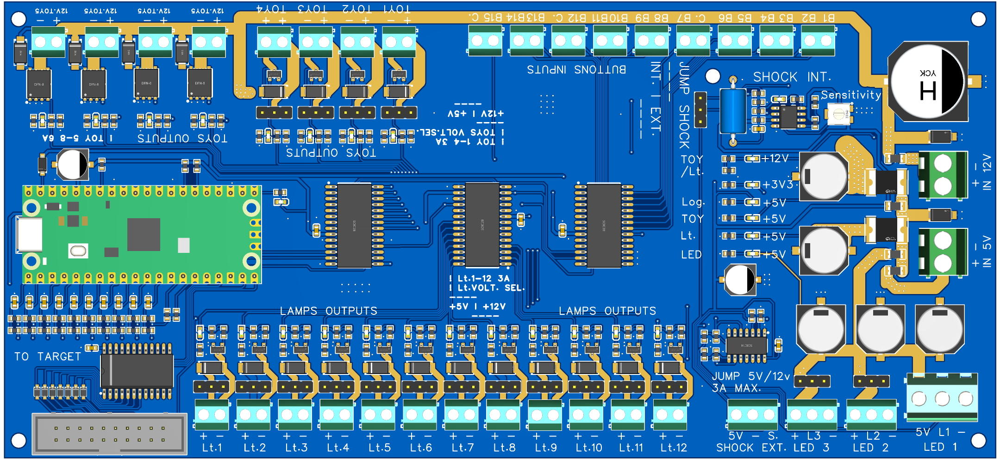

# DartsPico-Bridge

**Une borne de fléchettes RaspyDarts dont le matériel passe par deux cartes USB : une carte Pico pour la cible et une carte Interstate 75 W pour le DMD.**

DartsPico-Bridge, projet indépendant et non officiel, refond et réunit **RaspyDarts** (le jeu de fléchettes) et **Raspy2DMD** (l'afficheur DMD)
en un système à trois cartes. Le jeu et les animations restent sur le Raspberry Pi 4. Les deux autres cartes
lisent et écrivent les signaux électriques, avec le moins de logique possible, et sont reliées au Pi
par USB.

Le schéma des cartes et de leurs liaisons est expliqué dans [`docs/ARCHITECTURE.md`](docs/ARCHITECTURE.md).

Dépôt : <https://github.com/diogeneyves/DartsPico-Bridge>.

## Origine et crédits

- **[RaspyDarts](https://github.com/rmdelcelier/RaspyDarts)**, de rmdelcelier, sous licence **GNU GPL v3**.
  Le cœur du jeu (`raspydarts.py`) n'est pas réécrit : une nouvelle couche matériel, qui expose la même
  interface que l'original, est branchée par une série de patchs (`pi/patches/`). La version de référence
  est indiquée dans [`docs/UPSTREAM.md`](docs/UPSTREAM.md).
- **[Raspy2DMD](https://github.com/rmdelcelier/Raspy2DMD)**, du même auteur, sous licence **MIT**. Son rendu
  est réimplémenté d'après sa documentation publique et le comportement observé, pour ce que RaspyDarts utilise
  (texte, scores, images, GIF, Attract Mode).
- **[pimoroni-pico](https://github.com/pimoroni/pimoroni-pico)** (MIT) : le pilote HUB75 utilisé par le firmware
  de l'Interstate 75 W, dont la mention de licence est conservée.

## Les trois cartes

| Carte | Langage | Rôle |
|---|---|---|
| **Raspberry Pi 4** (Raspberry Pi OS Trixie 32 bits) | Python | Le jeu RaspyDarts, le démon matériel `hwd`, le service de rendu du DMD et le MQTT local (Mosquitto). |
| **Carte Pico** (Raspberry Pi Pico 2 sur le PCB « Darts ») | MicroPython | Matrice de la cible ED110, 15 boutons, 8 Toys, 12 voyants, 3 sorties LED WS2812 et détecteur de choc. |
| **Interstate 75 W** (Pimoroni) | C++ | Affichage de deux dalles HUB75 P4 64 × 32 en chaîne, soit une image de 128 × 32 pixels. |

Deux règles de sécurité valent pour toutes les sorties : elles sont **à zéro au démarrage**, et elles sont
**coupées par un chien de garde** si le Pi ne répond plus. Si une carte manque, le jeu démarre quand même :
sans cible si la carte Pico est absente, sans DMD si l'Interstate 75 W est absente.

## État actuel

**Fait et testé sans carte** (contre les simulateurs de `tools/`) :

- **M0** : arborescence, spécification, `hardware/pinout.json` généré depuis le projet EasyEDA, intégration continue.
- **M1** : protocoles Pi ↔ Pico (`shared/pico_proto.py`) et Pi ↔ Interstate 75 W (`shared/dmd_proto.py`),
  faux Pico et fausse carte 75 W.
- **M2** : démon matériel `hwd` (`pi/hwd/`), couche d'intégration (`pi/raspydarts_layer/`) et patchs du jeu
  (`pi/patches/`).
- **M3** : firmware MicroPython de la carte Pico (`firmware/pico_target/`), logique testée sur PC avec un module
  `machine` simulé.
- **M4** : service de rendu du DMD (`pi/dmd/`) et firmware C++ de l'Interstate 75 W (`firmware/i75w_display/`),
  dont le `.uf2` est compilé par la CI.

**Premières mesures sur carte** : essai de débit USB de l'Interstate 75 W, carte seule et sans dalles,
le 25 novembre 2026 : 15 images/s tenues, 89,7 images/s au maximum (spécification § 11.3).

**Reste à faire** (jalon **M5**, mise en service sur les cartes réelles, spécification § 11 et § 12) :

- Interstate 75 W **avec les dalles** : cadence d'images et température.
- Carte Pico : contrôle des rails et du bus I2C, Toys, voyants, boutons, LED, puis **calibration de la cible**.
- Détecteur de choc : polarité et seuil du capteur, valeur réelle de la fenêtre des tirs manqués (`miss_window_ms`).
- Échauffement du fusible F2 et de ses pistes, anneau de LED en blanc plein.
- Les autres questions ouvertes sont listées au § 12 de la spécification.

## Structure du dossier

```
docs/                    spécification, architecture, procédures, journal des décisions
hardware/                projet EasyEDA, pinout.json (brochage réel, source de vérité)
shared/                  protocoles, code commun au Pi et à la carte Pico
firmware/pico_target/    firmware MicroPython de la carte Pico
firmware/i75w_display/   firmware C++ de l'Interstate 75 W (Pico SDK, pilote HUB75 de pimoroni-pico)
pi/hwd/                  démon matériel, seul propriétaire des deux ports USB
pi/dmd/                  service de rendu du DMD
pi/raspydarts_layer/     couche matériel branchée dans RaspyDarts
pi/patches/              modifications de RaspyDarts (mode Pico)
pi/systemd/, pi/udev/    services et règles udev (/dev/cible, /dev/dmd)
tools/                   installation, banc, faux Pico, fausse carte 75 W
tests/                   tests unitaires, aucune carte nécessaire
```

## Documents

- [`docs/SPECIFICATION.md`](docs/SPECIFICATION.md) : la référence (matériel, protocoles USB, firmware, tests).
- [`docs/ARCHITECTURE.md`](docs/ARCHITECTURE.md) : schéma des trois cartes, des liaisons et de l'alimentation.
- [`docs/INSTALLATION.md`](docs/INSTALLATION.md) : installation complète, d'un Pi 4 neuf au jeu avec les deux cartes (brouillon).
- [`docs/PROCEDURE.md`](docs/PROCEDURE.md) : mise en service du Raspberry Pi.
- [`docs/PI_INTERFACE.md`](docs/PI_INTERFACE.md) : ce que le jeu demande au matériel, et comment la nouvelle couche y répond.
- [`hardware/pinout.json`](hardware/pinout.json) : brochage réel de la carte Pico.
- [`hardware/Darts_PCB_3D.png`](hardware/Darts_PCB_3D.png) : rendu 3D de la carte Pico.



*Rendu 3D de la carte Pico (PCB Darts, EasyEDA, 26/11/2026)*

## Tests

Python 3.11 ou plus récent ; aucune carte n'est nécessaire :

```bash
python3 -m unittest discover -s tests -v
```

- **Pillow** est facultatif : sans lui, les tests du rendu du DMD sont sautés (76 tests aujourd'hui). La CI
  installe **Pillow 11.1.0**, la version du Pi (spécification § 9.9).
- **paho-mqtt** n'est pas nécessaire : les tests utilisent un faux paho (`tests/fake_mqtt.py`).
- Les tests qui lisent le vrai code de RaspyDarts ont besoin d'une copie au commit de `pi/patches/BASE`, désignée
  par `RASPYDARTS_ORIG` (défaut `~/RaspyDarts-ref465`, voir [`docs/UPSTREAM.md`](docs/UPSTREAM.md)). Sans copie,
  ils sont sautés ; la CI la clone.

## Licence

**GNU GPL v3** (texte complet dans [`LICENSE`](LICENSE)), comme RaspyDarts dont le code est dérivé. Le pilote
HUB75 de pimoroni-pico conserve sa mention MIT. Aucun code de Raspy2DMD n'est copié : son rendu est réimplémenté
(spécification § 9.3, complément 76).
