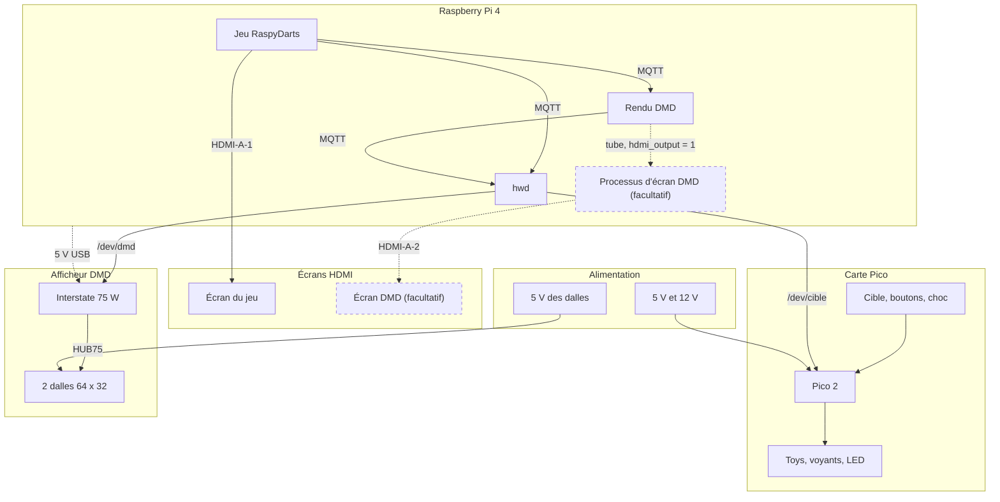

# Architecture de DartsPico-Bridge

Vue d'ensemble des trois cartes, de leurs liaisons et de leur alimentation. La référence détaillée reste
[`SPECIFICATION.md`](SPECIFICATION.md) ; chaque bloc ci-dessous renvoie à sa section.

Lecture du schéma (traits pleins : données ou puissance ; traits pointillés : l'Interstate 75 W alimentée par
l'USB du Pi, et la chaîne facultative de l'écran DMD HDMI, cadres compris) :

- **Pi 4** : les trois éléments échangent par le broker **MQTT local** (Mosquitto). Le jeu envoie ses messages DMD
  au rendu et ses commandes à `hwd`, et reçoit de `hwd` les événements de la cible ; le rendu publie des images
  **RGB565 de 128 × 32** que `hwd` transmet à l'Interstate 75 W. Les liaisons avec les cartes vont dans les deux
  sens.
- **Écrans HDMI** : le jeu s'affiche sur l'écran du 1er port micro-HDMI (`HDMI-A-1`). Un **écran DMD
  facultatif** peut être branché sur le 2e port (`HDMI-A-2`) : clé `hdmi_output` de `/etc/raspydarts/dmd.toml`,
  **`0` (coupé) par défaut**. Le service de rendu lance alors un **processus séparé**
  (`pi/dmd/dmd_hdmi_screen.py`) et lui passe ses images par un tube ; `hwd` et le jeu sont inchangés. Cet écran
  marche **avec l'Interstate 75 W ou à sa place** (§ 9.9, compléments 72 à 75).
- **Carte Pico** : entrées = cible ED110, 15 boutons, détecteur de choc ; sorties = 8 Toys, 12 voyants, 3 sorties
  LED WS2812.
- **DMD** : les deux dalles P4 64 × 32 sont chaînées (HUB75 de la carte vers la dalle n° 1, puis vers la n° 2).
- **Alimentation** : l'alimentation 5 V des dalles passe par un fusible d'au moins 4 A par dalle, avec un fil
  de masse épais vers les dalles ; la carte Pico reçoit le 5 V sur `P1` et le 12 V des Toys sur `P3` ; le Pi
  et l'alimentation des dalles sont mis sous tension ensemble (même interrupteur ou multiprise).

## Raspberry Pi 4

Cœur du système, sous Raspberry Pi OS Trixie 32 bits (§ 1). Il fait tourner quatre éléments :

- **Le jeu RaspyDarts**, dont le cœur n'est pas réécrit : une couche matériel (`pi/raspydarts_layer/`, patchs de
  `pi/patches/`) remplace l'accès direct aux GPIO par des messages MQTT (§ 9.1 et § 9.5).
- **Le broker MQTT local** (Mosquitto), qui n'écoute qu'en local, sur le port 1883 ; latence mesurée de moins de
  5 ms aller-retour (§ 2 et § 9.7).
- **Le démon matériel `hwd`** (`pi/hwd/`) : seul propriétaire des deux ports série. Il traduit les sujets
  `raspydarts/hw/…` en trames USB et inversement (§ 9.5).
- **Le service de rendu du DMD** (`pi/dmd/`) : il reçoit les messages DMD du jeu (sujets `raspydarts/dmd` et
  `raspy2dmd`), décode les GIF, met en forme le texte et publie des images complètes RGB565 de 8 192 octets sur
  `raspydarts/hw/dmd/frame`, à 15 images/s pendant une animation et au moins une fois par seconde sinon (§ 9.9).

## Carte Pico

PCB EasyEDA « Darts », équipé d'un **Raspberry Pi Pico 2** (RP2350A) sous **MicroPython** (§ 1 et § 7). Il lit la
matrice de la cible ED110, les 15 boutons et le détecteur de choc, et pilote les 8 Toys, les 12 voyants et
3 sorties LED WS2812 (cible, ruban accessoire, secours) (§ 3.3 à § 3.6). Le brochage réel est dans
[`hardware/pinout.json`](../hardware/pinout.json).

**Liaison** : USB série, nom stable **`/dev/cible`** donné par une règle udev selon le VID:PID et le numéro de
série (`pi/udev/73-dartspico-bridge.rules`, § 2). Protocole en lignes de texte, décrit au § 5.

**Alimentation** (§ 3.7) : entrée **5 V** sur `P1` (fusible 20 A), répartie en rails protégés chacun par son
fusible (logique, LED de la cible, voyants, Toys en 5 V) ; entrée **12 V** sur `P3` (fusible 20 A) pour les
Toys T5 à T8 et les sorties réglées en 12 V. Le Pico est alimenté par VSYS depuis le rail logique `+5V_LOG`, à
travers la diode D1 ; son VBUS n'est pas connecté (§ 3.1). Le courant des LED de la cible est bridé par le
firmware (`led_max_ma`, 10 000 mA par défaut, § 3.7).

**Sécurité** : sorties à zéro au démarrage et coupées par un chien de garde si le Pi ne répond plus (§ 5.4).

## Interstate 75 W et dalles

Carte **Pimoroni Interstate 75 W** (RP2350A), firmware en **C++** (Pico SDK, pilote HUB75 de pimoroni-pico) :
le cœur 0 reçoit l'USB et décode les zones, le cœur 1 rafraîchit les dalles (§ 4 et § 8). Elle pilote
**deux dalles P4 64 × 32** chaînées, pour une image de **128 × 32 pixels** (§ 4).

**Liaison** : USB série, nom stable **`/dev/dmd`** (§ 2). Trames binaires avec CRC-32 (§ 6.1). La carte ne
décode rien : `hwd` envoie des images **RGB565** prêtes, en ne transmettant que les tuiles de 8 × 8 pixels qui
ont changé (trame `DELTA`, compressée), plus une image complète (`FRAME`) au moins une fois par seconde
(§ 6.4). La carte travaille en double tampon : l'image n'est échangée qu'une fois complète (§ 6.4).

**Alimentation** (§ 4, complément 29) :

- la carte est alimentée **uniquement par l'USB du Pi**, par un câble USB-C ordinaire ; ses **bornes à vis restent
  vides** (étiquette « NE RIEN BRANCHER ») ;
- les dalles sont alimentées **directement par l'alimentation 5 V**, avec un fusible d'au moins 4 A par dalle et
  un **fil de masse épais** entre dalles et alimentation, sans retour de courant par le câble HUB75 ni par l'USB ;
  le connecteur HUB75 ne porte que des signaux et la masse ;
- le Pi et l'alimentation des dalles sont **mis sous tension et hors tension ensemble** (même interrupteur ou
  même multiprise), car les sorties de la carte alimenteraient sinon des dalles éteintes par leurs entrées.

## Fonctionnement dégradé

Si la carte Pico est absente, le jeu démarre en mode « sans cible » ; si l'Interstate 75 W est absente, il
fonctionne sans DMD (§ 2).
